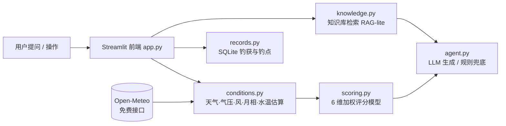
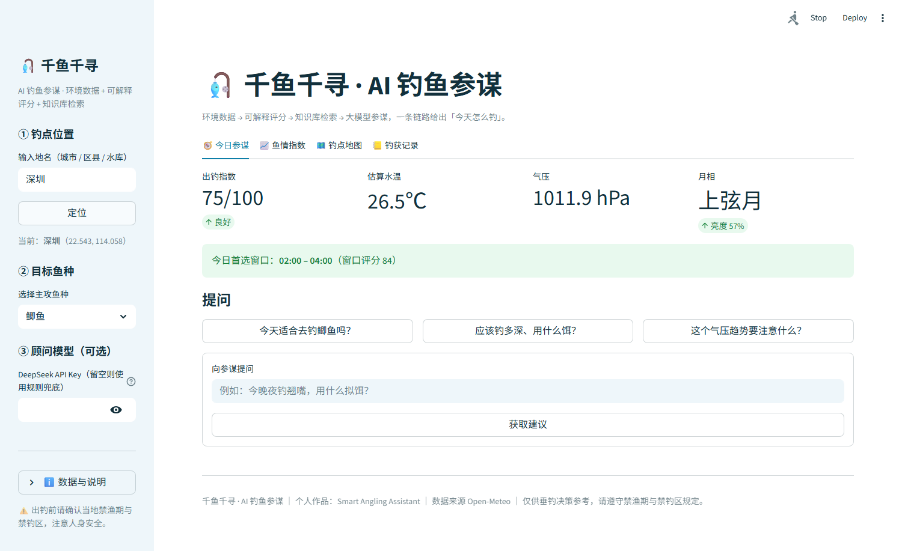
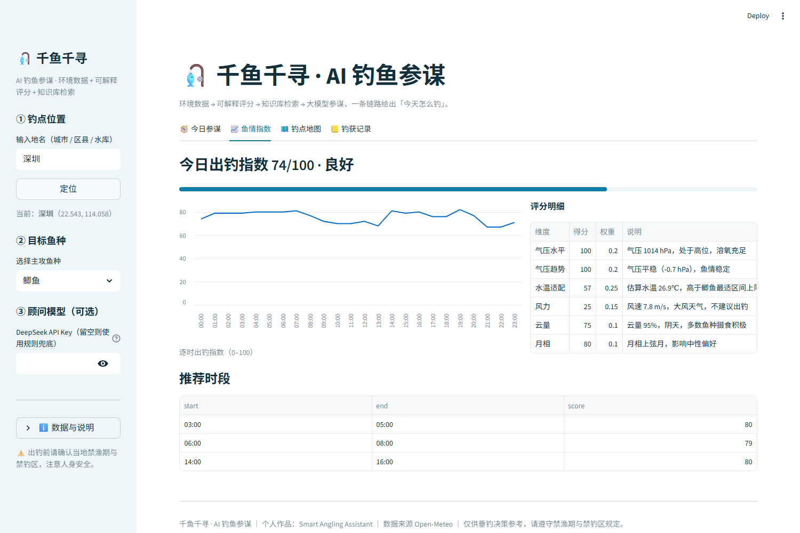
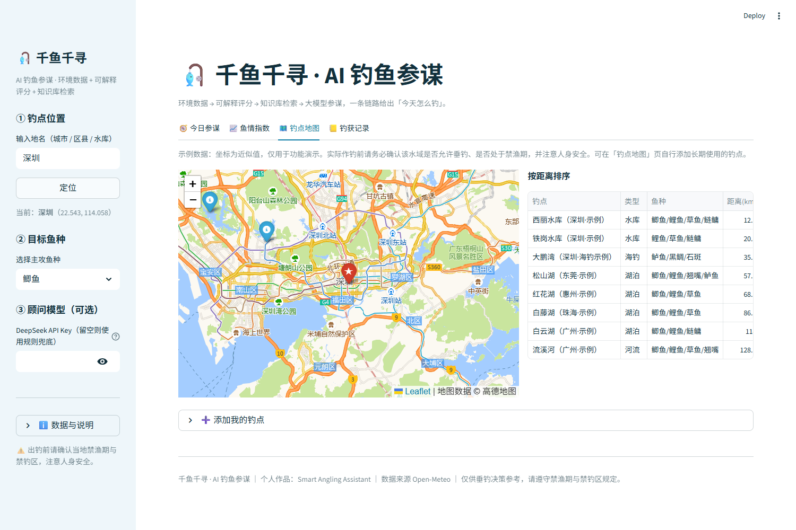
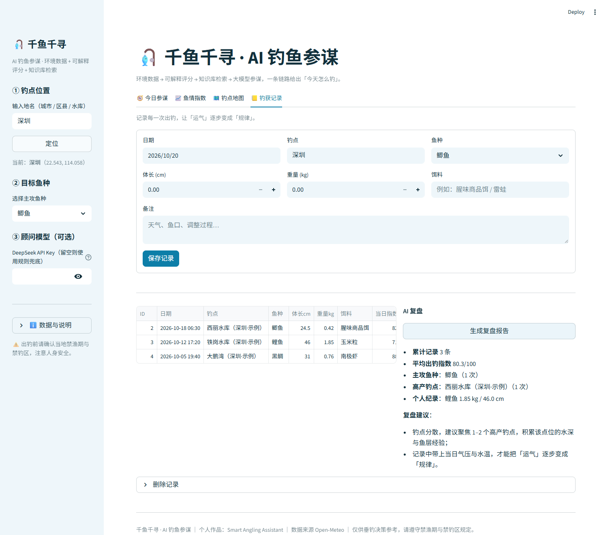

# 🎣 千鱼千寻 · AI 钓鱼参谋

> **Smart Angling Assistant** —— 把「今天去哪钓、怎么钓」这件事，交给一条可解释的 AI 决策链路。

一个面向垂钓场景的 AI 决策助手：接入实时环境数据，用**可解释的加权评分模型**算出当日出钓指数，再结合**专业垂钓知识库检索**与大模型，输出可直接执行的作钓建议，并把每次出钓沉淀为可复盘的个人数据。

- 🚀 在线体验：（部署后填写线上地址）
- 📦 代码仓库：本仓库
- 👤 作者：望天云（南方科技大学 · 智能制造与机器人 硕士）

---

## ✨ 项目亮点

| 亮点 | 说明 |
|---|---|
| **可解释，不黑箱** | 出钓指数由 6 个维度加权计算，每个维度的得分与理由都会明示，而非直接抛一个结论 |
| **零配置可用** | 环境数据用 Open-Meteo 免费接口；未配置大模型 Key 时自动降级为规则回答，部署即用 |
| **RAG 知识注入** | 内置 24 条垂钓专业条目，提问时先检索再注入，让回答有据可依而不是凭空生成 |
| **完整数据闭环** | 从「看天气 → 选钓点 → 拿建议 → 记录钓获 → AI 复盘」，覆盖一次出钓的全过程 |
| **成本敏感设计** | 全栈仅 5 个依赖，单文件 SQLite 存储，可直接跑在免费托管平台上 |

---

## 🧩 功能模块

### 1. 🧭 今日参谋（对话式 Agent）
输入自然语言问题（如「今晚夜钓翘嘴用什么拟饵？」），系统先检索知识库，再把「实时环境摘要 + 检索片段」注入大模型生成建议；未配置 Key 时由规则模板兜底。对话中会展示本次引用的知识条目，保证**结论可追溯**。

### 2. 📈 鱼情指数（可解释评分）
输出 0–100 的出钓指数与等级，并给出逐项明细：

| 维度 | 权重 | 判据 |
|---|---|---|
| 气压水平 | 20% | 1010–1025 hPa 最适；<1005 hPa 明显偏低压 |
| 气压趋势 | 20% | 24h 内缓变最佳；骤变 >5 hPa 易导致鱼口紊乱 |
| 水温适配 | 25% | 对比目标鱼种最适温区（鲫 12–22℃ / 鲤 16–26℃ / 草 20–30℃ / 鲢鳙 22–32℃ …） |
| 风力 | 15% | 2–5 m/s 微风最利于观漂与增氧 |
| 云量 | 10% | 30–80% 散射光条件理想 |
| 月相 | 10% | 新月/满月前后摄食活跃度偏高 |

同时按 3 小时滑窗扫描全天，输出**推荐作钓时段**。

### 3. 🗺️ 钓点地图
地图展示钓点分布与当前定位，按距离排序；支持在海图上点击选点直接切换钓点，并可添加自建钓点（本地持久化）。

### 4. 📒 钓获记录 & AI 复盘
录入每次出钓的鱼种、尺寸、饵料，并自动关联当日气压与水温；基于历史记录生成规则化复盘（高产钓点、主攻鱼种、个人纪录与调整建议），让「运气」逐步变成「规律」。

---

## 🏗️ 技术架构



**技术栈**：Python 3.9 · Streamlit · Folium · Pandas · Requests · SQLite
**外部数据**：Open-Meteo 预报与地理编码接口（无需 API Key）
**可选模型**：任意 OpenAI 兼容接口（默认 DeepSeek `deepseek-chat`）

---

## 📁 目录结构

```
angling-ai/
├── app.py                     # Streamlit 主入口（4 个功能页）
├── requirements.txt
├── .streamlit/config.toml     # 主题配置
├── modules/
│   ├── conditions.py          # 环境数据获取与派生计算
│   ├── scoring.py             # 出钓指数评分模型
│   ├── knowledge.py           # 知识库检索
│   ├── agent.py               # 对话式 Agent（LLM + 规则兜底）
│   └── records.py             # 钓获/钓点存储与复盘
└── data/
    ├── knowledge_base.json    # 24 条垂钓知识条目
    └── spots.json             # 示例钓点
```

---

## 🚀 快速开始

```bash
# 1. 安装依赖
pip install -r requirements.txt

# 2. 启动
streamlit run app.py

# 3. 浏览器打开 http://localhost:8501
```

**可选：启用大模型建议**

```bash
# 方式一：环境变量
export DEEPSEEK_API_KEY=你的Key        # Windows PowerShell: $env:DEEPSEEK_API_KEY="你的Key"

# 方式二：在页面左侧边栏直接填入（推荐，随用随填）
```

> 不配置也能完整使用：所有功能会自动降级为规则回答。

---

## ☁️ 部署

**Streamlit Community Cloud（最省事）**
1. 把本仓库推到 GitHub（公开）；
2. 打开 share.streamlit.io，选择该仓库，主文件填 `app.py`，点击 Deploy；
3. 如需大模型能力，在 App 的 Secrets 里配置：
   ```toml
   DEEPSEEK_API_KEY = "你的Key"
   ```

**Hugging Face Spaces**：新建 Space 选择 Streamlit SDK，上传本仓库即可。

---

## 📸 截图

### 🧭 今日参谋


### 📈 鱼情指数（可解释评分）


### 🗺️ 钓点地图


### 📒 钓获记录 & AI 复盘


---

## ⚠️ 免责声明

本项目为**决策辅助工具**，输出结论基于公开气象数据与通用垂钓经验，**不构成任何垂钓保证**。水温为气温滞回模型估算值，误差通常在 ±2℃ 内。请务必遵守当地**禁渔期与禁钓区**规定，注意涉水安全，带走垃圾。

---

## 👤 关于作者

望天云，南方科技大学智能制造与机器人方向硕士，关注 AI 与实体场景的结合。

- 南科大钓鱼协会 高级顾问（Senior Advisor）
- 深客松 2025（DeepHackathon）银奖 —— 本项目即由当时的黑客松原型演进而来
- 2026 探鱼器挑战杯 铜奖
