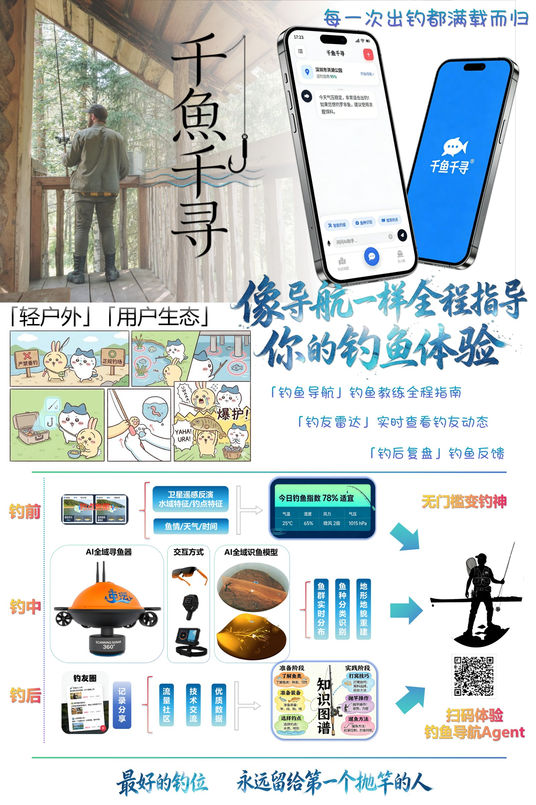
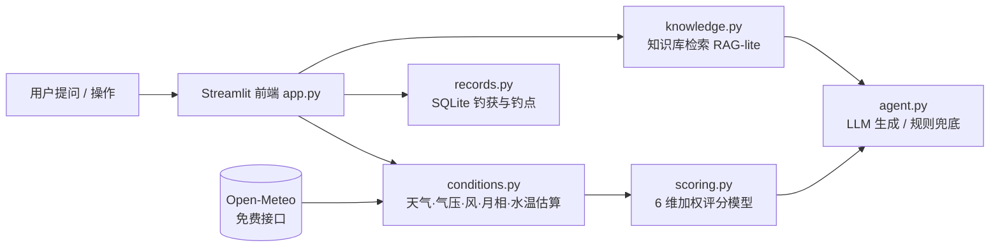
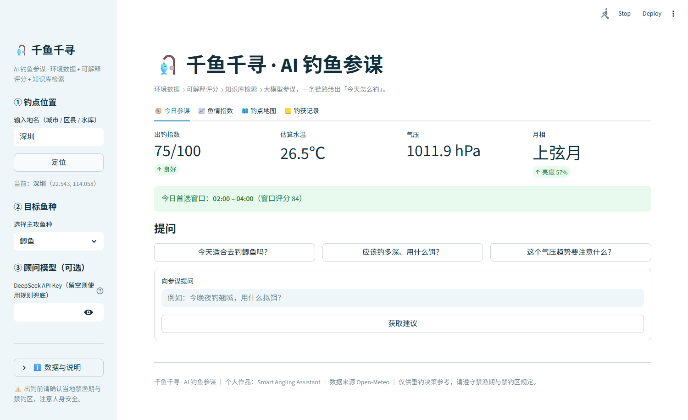
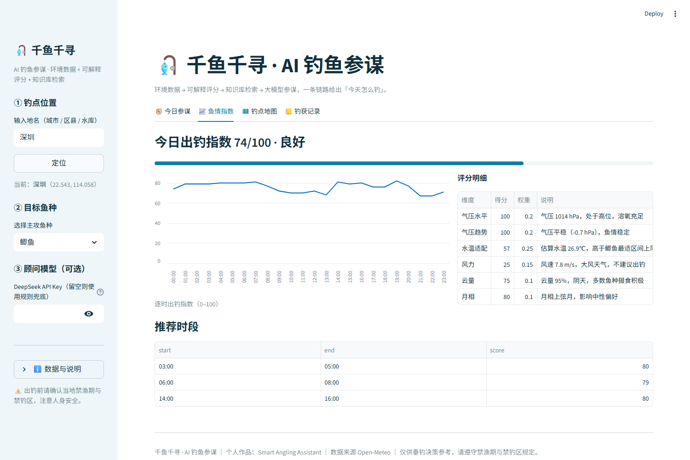
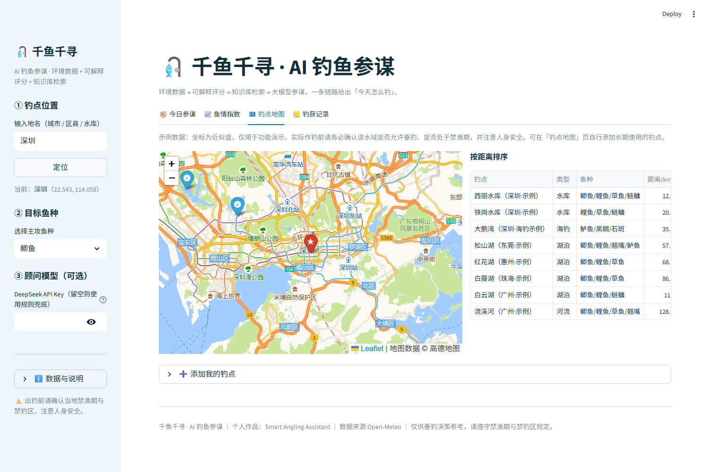
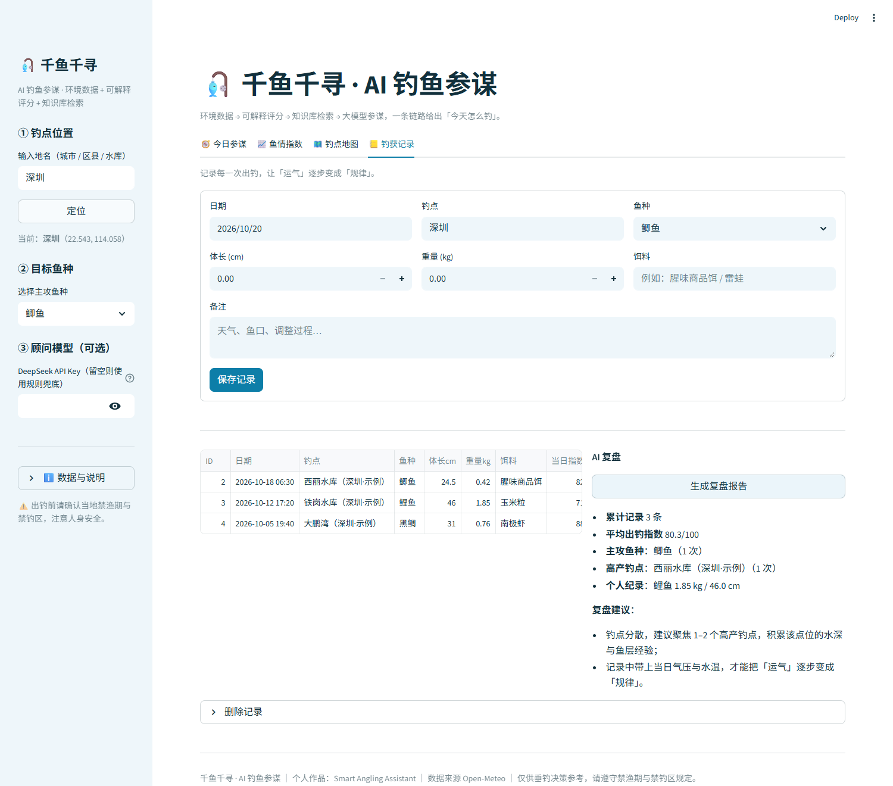

# 🎣 千鱼千寻 · AI 钓鱼参谋

> **Smart Angling Assistant** —— 把「今天去哪钓、怎么钓」这件事，交给一条可解释的 AI 决策链路。

一个面向垂钓场景的 AI 决策助手：接入实时环境数据，用**可解释的加权评分模型**算出当日出钓指数，再结合**专业垂钓知识库检索**与大模型，输出可直接执行的作钓建议，并把每次出钓沉淀为可复盘的个人数据。

- 🚀 在线体验：https://angling-ai-266sqs778.streamlit.app
- 🧭 新手导航示例：https://266sqs778.github.io/angling-ai/
- 📦 代码仓库：本仓库
- 👤 作者：AXA（国内双一流高校 · 智能制造与机器人 硕士）

---

## ✨ 项目亮点

| 亮点 | 说明 |
|---|---|
| **可解释，不黑箱** | 出钓指数由 6 个维度加权计算，每个维度的得分与理由都会明示，而非直接抛一个结论 |
| **零配置可用** | 环境数据用 Open-Meteo 免费接口；未配置大模型 Key 时自动降级为规则回答，部署即用 |
| **RAG 知识注入** | 内置 24 条垂钓专业条目，提问时先检索再注入，让回答有据可依而不是凭空生成 |
| **完整数据闭环** | 从「看天气 → 选钓点 → 拿建议 → 记录钓获 → AI 复盘」，覆盖一次出钓的全过程 |
| **新手也能用** | 「钓鱼导航」把一次出钓拆成钓前 / 钓中 / 钓后，用知识图谱与图文步骤回答新手最常问的三个问题 |
| **成本敏感设计** | 全栈仅 5 个依赖，单文件 SQLite 存储，可直接跑在免费托管平台上 |

---

## 🧩 功能模块

### 1. 🧭 今日参谋（对话式 Agent）
输入自然语言问题（如「今晚夜钓翘嘴用什么拟饵？」），系统先检索知识库，再把「实时环境摘要 + 检索片段」注入大模型生成建议；未配置 Key 时由规则模板兜底。对话中会展示本次引用的知识条目，保证**结论可追溯**。

### 2. 📈 鱼情指数（可解释评分）
输出 0–100 的出钓指数与等级，并给出逐项明细：

| 维度 | 权重 | 判据 |
|---|---|---|
| 气压水平 | 20% | 1010–1025 hPa 最适；<1005 hPa 明显偏低压 |
| 气压趋势 | 20% | 24h 内缓变最佳；骤变 >5 hPa 易导致鱼口紊乱 |
| 水温适配 | 25% | 对比目标鱼种最适温区（鲫 12–22℃ / 鲤 16–26℃ / 草 20–30℃ / 鲢鳙 22–32℃ …） |
| 风力 | 15% | 2–5 m/s 微风最利于观漂与增氧 |
| 云量 | 10% | 30–80% 散射光条件理想 |
| 月相 | 10% | 新月/满月前后摄食活跃度偏高 |

同时按 3 小时滑窗扫描全天，输出**推荐作钓时段**。

### 3. 🗺️ 钓点地图
地图展示钓点分布与当前定位，按距离排序；支持在海图上点击选点直接切换钓点，并可添加自建钓点（本地持久化）。

### 4. 📒 钓获记录 & AI 复盘
录入每次出钓的鱼种、尺寸、饵料，并自动关联当日气压与水温；基于历史记录生成规则化复盘（高产钓点、主攻鱼种、个人纪录与调整建议），让「运气」逐步变成「规律」。

---

## 🧭 钓鱼导航：给新手的一条最短路径

老手要的是「今天鱼口如何」，新手要的是「我该从哪一步开始」。同一套数据，对两类人要用两种讲法：前者给结论，后者给路径。

「钓鱼导航」把一次出钓拆成三段，每段只回答新手最关心的一个问题：

| 阶段 | 新手的问题 | 导航给什么 |
|---|---|---|
| **钓前** | 去哪、钓什么、几点去 | 结合天气、气压、水温与目标鱼种，给出钓点、时段与基础装备清单 |
| **钓中** | 现在该怎么钓 | 按鱼种与水域给钓法、线组、饵料建议，同时提示安全边界与禁渔规定 |
| **钓后** | 这次为什么空军 | 把钓获与环境数据一起复盘，转成下一次可执行的调整 |

支撑它的是「公开知识 + 本地知识库」：把公开垂钓资料整理成可检索条目，输出带出处的图文步骤，而不是一句没有依据的结论。海报中同时展示了**钓友雷达**（实时钓友动态）与**钓后复盘**的生态设想。

> **实现状态**：今日参谋、鱼情指数、钓点地图、钓获复盘已在本仓库实现；「钓鱼导航」已有一份可交互的六步示例页，完整形态见海报设计稿。

**示例页：第一次出钓怎么走** → https://266sqs778.github.io/angling-ai/
出发前 → 选位 → 线组 → 调漂 → 开钓收竿 → 空军复盘，29 个勾选项自动保存进度，支持打印。最后一步把“没口”拆成天气、选位、线组、调漂四类排查，接成“记录 → 复盘 → 调整”的闭环。

[](assets/05-poster.pdf)

*点击海报查看原尺寸 PDF（A3 展示稿）*

---

## 🏗️ 技术架构



**技术栈**：Python 3.9 · Streamlit · Folium · Pandas · Requests · SQLite
**外部数据**：Open-Meteo 预报与地理编码接口（无需 API Key）
**可选模型**：任意 OpenAI 兼容接口（默认 DeepSeek `deepseek-chat`）

---

## 📁 目录结构

```
angling-ai/
├── app.py                     # Streamlit 主入口（4 个功能页）
├── requirements.txt
├── .streamlit/config.toml     # 主题配置
├── assets/
│   ├── 01-advisor.png … 04-records.png
│   ├── 05-poster.jpg          # 产品海报（网页展示版）
│   └── 05-poster.pdf          # 产品海报（A3 原稿）
├── modules/
│   ├── conditions.py          # 环境数据获取与派生计算
│   ├── scoring.py             # 出钓指数评分模型
│   ├── knowledge.py           # 知识库检索
│   ├── agent.py               # 对话式 Agent（LLM + 规则兜底）
│   └── records.py             # 钓获/钓点存储与复盘
└── data/
    ├── knowledge_base.json    # 24 条垂钓知识条目
    └── spots.json             # 示例钓点
```

---

## 🚀 快速开始

```bash
# 1. 安装依赖
pip install -r requirements.txt

# 2. 启动
streamlit run app.py

# 3. 浏览器打开 http://localhost:8501
```

**可选：启用大模型建议**

```bash
# 方式一：环境变量
export DEEPSEEK_API_KEY=你的Key        # Windows PowerShell: $env:DEEPSEEK_API_KEY="你的Key"

# 方式二：在页面左侧边栏直接填入（推荐，随用随填）
```

> 不配置也能完整使用：所有功能会自动降级为规则回答。

---

## ☁️ 部署

**Streamlit Community Cloud（最省事）**
1. 把本仓库推到 GitHub（公开）；
2. 打开 share.streamlit.io，选择该仓库，主文件填 `app.py`，点击 Deploy；
3. 如需大模型能力，在 App 的 Secrets 里配置：
   ```toml
   DEEPSEEK_API_KEY = "你的Key"
   ```

**Hugging Face Spaces**：新建 Space 选择 Streamlit SDK，上传本仓库即可。

---

## 📸 截图

### 🧭 今日参谋


### 📈 鱼情指数（可解释评分）


### 🗺️ 钓点地图


### 📒 钓获记录 & AI 复盘


---

## ⚠️ 免责声明

本项目为**决策辅助工具**，输出结论基于公开气象数据与通用垂钓经验，**不构成任何垂钓保证**。水温为气温滞回模型估算值，误差通常在 ±2℃ 内。请务必遵守当地**禁渔期与禁钓区**规定，注意涉水安全，带走垃圾。

---

## 👤 关于作者

AXA，智能制造与机器人方向硕士，关注 AI 与实体场景的结合。

- 高校钓鱼社团 高级顾问（Senior Advisor）
- 2025 年某高校黑客松 银奖 —— 本项目即由当时的黑客松原型演进而来
- 2026 年某省级挑战杯 铜奖
